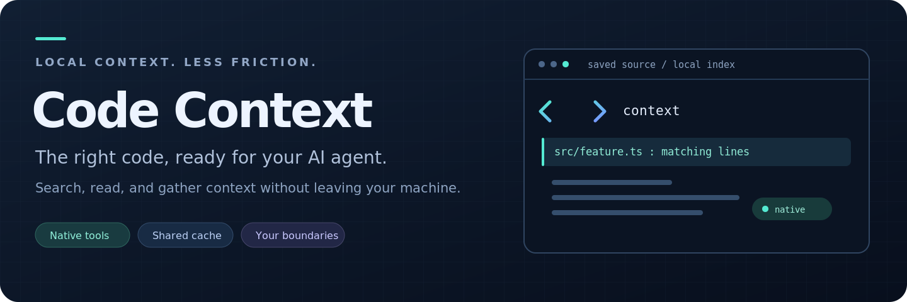
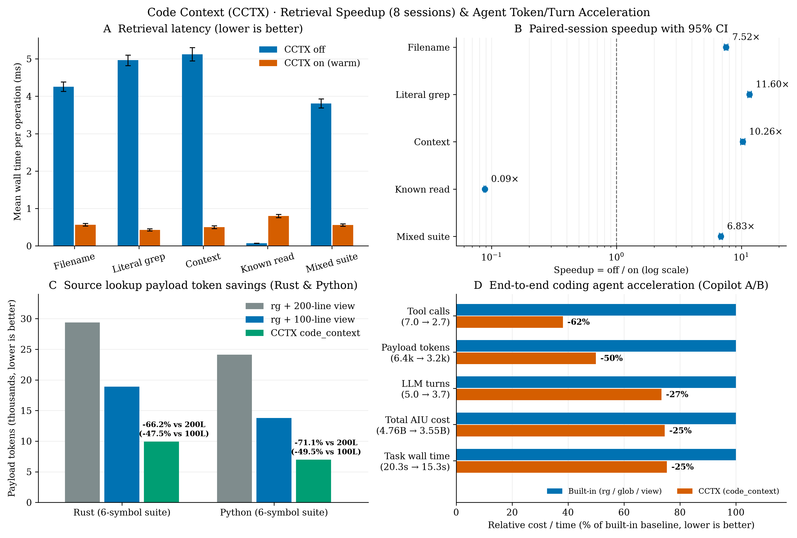

<p align="center">
  
</p>

# Code Context

Fast local file discovery, source search, and smart block-clamped context for coding agents.
Runs as a **native VS Code Language Model Tools extension** (`#cctxNativeContext`, `#cctxNativeGrep`, `#cctxNativeRead`, `#cctxNativeFiles`) and MCP server backed by one shared Rust cache on **Linux, native Windows (`cctx.exe`), WSL, and SSH**.
A cold cache returns immediately so normal tools can continue.

## Install

**Requirements:** Linux, **native Windows (`cctx.exe`, no WSL required)**, WSL, or Linux SSH; stable Rust; ripgrep (`rg`). The VS Code extension requires VS Code 1.140+ and automatically injects agent usage instructions (`applyTo: "**"`).

**1. Install the backend** (Linux/WSL/SSH or native Windows PowerShell):

```sh
# Linux / WSL / SSH:
git clone https://github.com/dotnetpower/code-context.git
cd code-context && bash scripts/install.sh && ~/.local/bin/cctx ping
# Native Windows (PowerShell): cargo build --locked --release; copy target\release\cctx.exe $HOME\.local\bin\cctx.exe
```

**2. Install [Code Context by dotnetpower from Marketplace](https://marketplace.visualstudio.com/items?itemName=dotnetpower.code-context-native)**,
or run `code --install-extension dotnetpower.code-context-native` (or install the [VSIX](https://github.com/dotnetpower/code-context/releases/latest/download/code-context-native.vsix)).
The backend is installed separately; installing the extension alone is not enough.
Existing VSIX users should follow the [publisher migration guide](vscode-extension/docs/SETUP.md#extension-details-resources-and-vsix-updates).

**3. Open a trusted project** and run **Code Context: Getting Started**.
On native Windows, `cctx.exe daemon` starts automatically in the background on first use. Try:

> Use `#cctxNativeFiles` to find `*Service*`, then `#cctxNativeContext` to inspect a symbol.

No proposed API flags are needed. For Windows Agents, SSH, manual registration,
or MCP-only clients, see the [setup guide](vscode-extension/docs/SETUP.md) and
[backend reference](docs/REFERENCE.md). Marketplace and GitHub VSIX distribution
use the same extension identity.

## Measured performance & token acceleration

On [AKS Store Demo](https://github.com/dotnetpower/aks-store-demo), the fixed
mixed retrieval suite averaged **6.83× faster with a warm CCTX cache**
(95% CI **6.65–7.06×**): **3.809 → 0.557 ms per operation**.
Replacing multi-turn `rg` + `view` reads with one block-clamped `code_context` call cuts **lookup payload tokens by 47.5–71.1%** and accelerates end-to-end coding agent completion by **24.7%**.



| Retrieval task (AKS Store Demo) | CCTX off | CCTX on, warm | Off / on |
|---|---:|---:|---:|
| Filename discovery | 4.257 ms | 0.566 ms | 7.52× |
| Literal search | 4.965 ms | 0.428 ms | 11.60× |
| Search + context | 5.122 ms | 0.499 ms | 10.26× |
| Known file read + hash | **0.070 ms** | 0.799 ms | **0.09× — slower** |
| Fixed mixed suite | 3.809 ms | 0.557 ms | 6.83× |

| Token & agent acceleration benchmark | Baseline (`rg` + `view`) | With CCTX (`code_context`) | Reduction / speedup |
|---|---:|---:|---:|
| Rust 6-symbol lookup payload tokens | 18,907 tok (100L) / 29,396 tok (200L) | **9,929 tok** (6 calls vs 21) | **-47.5% to -66.2% tokens** |
| Python 6-symbol lookup payload tokens | 13,799 tok (100L) / 24,126 tok (200L) | **6,971 tok** (6 calls vs 15, **10.65×** faster) | **-49.5% to -71.1% tokens** |
| Copilot A/B agent tool calls & LLM turns | 7.00 calls / 5.00 turns | **2.67 calls / 3.67 turns** | **-61.9% calls · -26.7% turns** |
| Copilot A/B agent payload tokens & AIU cost | 6,360 tok / 4.76B nanoAIU | **3,177 tok / 3.55B nanoAIU** | **-50.0% tokens · -25.4% cost** |
| Copilot A/B end-to-end task wall time | 20.31 s | **15.30 s** (100% accuracy both) | **-24.7% completion time** |

Eight daemon sessions, 40 rounds, 28 tasks, **8,960 correctness-checked pairs**.
Off bypasses CCTX with ripgrep/direct read/hash; on uses daemon RPC. Small known reads are faster without IPC. A cold miss plus fallback had a **4.325 ms median**, not a warm-cache speedup.
See [method, cold-start chart, token suites, raw samples, and reproduction](docs/BENCHMARKS.md) for uncertainty and limitations.

## Learn more

- [Setup and troubleshooting](vscode-extension/docs/SETUP.md)
- [CLI, MCP, cache behavior, memory, and privacy](docs/REFERENCE.md)
- [Architecture](DESIGN.md)
- [Packaging and publishing](vscode-extension/docs/PUBLISHING.md)
- [Releases](https://github.com/dotnetpower/code-context/releases) ·
  [Issues](https://github.com/dotnetpower/code-context/issues) · [MIT license](vscode-extension/LICENSE)
