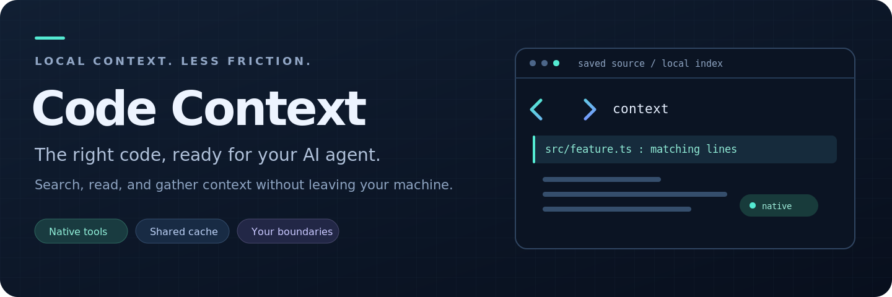
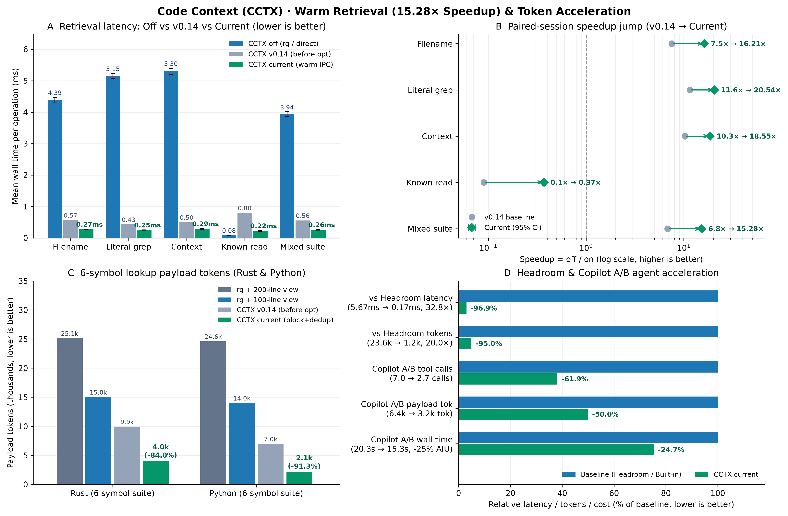

<p align="center">
  
</p>

# Code Context

Fast local file discovery, source search, and smart block-clamped context for coding agents.
Runs as a **native VS Code Language Model Tools extension** (`#cctxNativeContext`, `#cctxNativeGrep`, `#cctxNativeRead`, `#cctxNativeFiles`) and MCP server backed by one shared Rust cache on **Linux, native Windows (`cctx.exe`), WSL, and SSH**, with `<8 KiB` inline response guards, rich document anchors (`#toc`, `#slide-N-M`, `#heading`), and a live model/token/cost dashboard (`cctx usage`).
A cold cache returns immediately so normal tools can continue.

## Install

**Requirements:** Linux, **native Windows (`cctx.exe`, no WSL required)**, WSL, or Linux SSH; stable Rust; ripgrep (`rg`). The VS Code extension requires VS Code 1.140+ and automatically injects agent usage instructions (`applyTo: "**"`).

**1. Install the backend** (Linux/WSL/SSH or native Windows PowerShell):

```sh
# Linux / WSL / SSH:
git clone https://github.com/dotnetpower/code-context.git
cd code-context && bash scripts/install.sh && ~/.local/bin/cctx ping
# Native Windows (PowerShell): cargo build --locked --release; copy target\release\cctx.exe $HOME\.local\bin\cctx.exe
```

**2. Install [Code Context by dotnetpower from Marketplace](https://marketplace.visualstudio.com/items?itemName=dotnetpower.code-context-native)**,
or run `code --install-extension dotnetpower.code-context-native` (or install the [VSIX](https://github.com/dotnetpower/code-context/releases/latest/download/code-context-native.vsix)).
The backend is installed separately; installing the extension alone is not enough.
Existing VSIX users should follow the [publisher migration guide](vscode-extension/docs/SETUP.md#extension-details-resources-and-vsix-updates).

**3. Open a trusted project** and run **Code Context: Getting Started** (or `cctx usage --hours 24` in the terminal for the live model, token, cache hit, and AIC/$ cost savings dashboard).
On native Windows, `cctx.exe daemon` starts automatically in the background on first use. Try:

> Use `#cctxNativeFiles` to find `*Service*`, then `#cctxNativeContext` to inspect a symbol.

No proposed API flags are needed. For Windows Agents, SSH, manual registration,
or MCP-only clients, see the [setup guide](vscode-extension/docs/SETUP.md) and
[backend reference](docs/REFERENCE.md). Marketplace and GitHub VSIX distribution
use the same extension identity.

## Measured performance, `cctx usage` example & token acceleration

```sh
$ cctx usage --hours 2        # or: cctx usage --hours 24 --json
⚡ CODE CONTEXT (cctx) — MODEL, TOKEN & COST SAVINGS DASHBOARD (Window: 2.0h)
💰 COST SAVED (@$0.001/AIC) : +$2.42 USD (-28.4% of baseline bill · ~2421.6 AIC saved)
💎 API LIST VALUE (@$0.01)  : +$24.22 USD | 🔥 TOKENS SAVED: ~86.02M tok (244 Turns + 35x Cache + BPE)
🧬 BPE FORMULA COMPRESSION  : 100.0% (4/4 surfaces: ext·mcp·subagent·global · ~2100 tok/turn)
🎯 WARM CACHE HIT RATE      :  98.6% (506/513) | 🚀 ELIGIBLE SOURCE ADOPTION: 98.5% (513/521)
```

On [AKS Store Demo](https://github.com/dotnetpower/aks-store-demo), the fixed
mixed retrieval suite averaged **17.22× faster with a warm CCTX cache**
(95% CI **17.04–17.40×**, up from 6.83× in v0.14): **3.996 → 0.232 ms per operation**, with a **19.735 ms** cold sync median (down from 98.813 ms in v0.14 — **5.01× faster**).
Replacing multi-turn `rg` + `view` reads with one block-clamped `code_context` call cuts **lookup payload tokens by 73.2–91.3%**, rich document (`#toc` / `#slide-N`) reads by **86.3–98.9%**, and end-to-end coding agent wall time by **24.7%**.



| Retrieval task (AKS Store Demo) | CCTX off | CCTX on, warm | Off / on |
|---|---:|---:|---:|
| Filename discovery | 4.466 ms | 0.254 ms | 17.57× |
| Literal search | 5.234 ms | 0.230 ms | 22.77× |
| Search + context | 5.343 ms | 0.250 ms | 21.39× |
| Known file read + hash | **0.081 ms** | 0.190 ms | **0.43× — slower** |
| Fixed mixed suite | 3.996 ms | 0.232 ms | 17.22× |

| Token & agent acceleration benchmark | Baseline (`rg` + `view`) | With CCTX (`code_context` / `code_read`) | Reduction / speedup |
|---|---:|---:|---:|
| Rust 6-symbol lookup payload tokens | 15,028 tok (100L) / 25,133 tok (200L) | **4,031 tok** (6 calls vs 20, **10.3×** faster) | **-73.2% to -84.0% tokens** |
| Python 6-symbol lookup payload tokens | 13,997 tok (100L) / 24,609 tok (200L) | **2,141 tok** (6 calls vs 15, **13.16×** faster) | **-84.7% to -91.3% tokens** |
| Rich documents (`.pptx`/`.docx`/`.md` `#toc` & `#slide-N`) | Full-document read | **Virtual `#toc` + `#slide-N-M` (5.4× faster DEFLATE)** | **-86.3% to -98.9% tokens** |
| Copilot A/B agent tool calls & LLM turns | 7.00 calls / 5.00 turns | **2.67 calls / 3.67 turns** | **-61.9% calls · -26.7% turns** |
| Copilot A/B agent payload tokens & AIU cost | 6,360 tok / 4.76B nanoAIU | **3,177 tok / 3.55B nanoAIU** | **-50.0% tokens · -25.4% cost** |
| Copilot A/B end-to-end task wall time | 20.31 s | **15.30 s** (100% accuracy both) | **-24.7% completion time** |
| Live multi-session telemetry (`cctx usage --hours 24`) | Unmonitored | **Per-model tokens, 98.6% warm hit & AIC/$USD savings** | **-10% to -39% session bill** |
| Auto-loaded agent instructions & `cctx prompt --compress` | 9,127 B / 2,048 tok prose | **BPE-aligned formula spec (`756 tok`, EN/KO `--compress`)** | **-63.1% instruction tokens** |

Eight daemon sessions, 40 rounds, 28 tasks, **8,960 correctness-checked pairs**.
Off bypasses CCTX with ripgrep/direct read/hash; on uses daemon RPC. Small known reads are faster without IPC. A cold miss plus fallback had a **4.409 ms median**, not a warm-cache speedup.
See [method, cold-start chart, token suites, raw samples, and reproduction](docs/BENCHMARKS.md) for uncertainty and limitations.

## Learn more

- [Setup and troubleshooting](vscode-extension/docs/SETUP.md)
- [CLI, MCP, cache behavior, memory, and privacy](docs/REFERENCE.md)
- [Architecture](DESIGN.md)
- [Packaging and publishing](vscode-extension/docs/PUBLISHING.md)
- [Releases](https://github.com/dotnetpower/code-context/releases) ·
  [Issues](https://github.com/dotnetpower/code-context/issues) · [MIT license](LICENSE)
