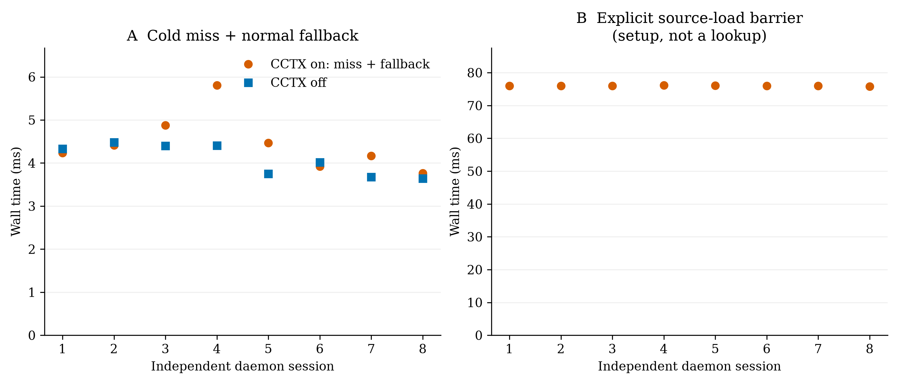

# Retrieval benchmark: CCTX off versus on

## Result and scope

The fixed mixed suite took **3.809 ms per operation without CCTX** and
**0.557 ms with a warm CCTX cache**: **6.83x** speedup, 95% confidence interval
**6.65–7.06x**, or **85.4% less retrieval wall time** in this experiment.
This is a retrieval microbenchmark, **not** a claim of faster LLM generation,
VS Code chat, model tool selection, token savings, or whole-agent completion.


**Figure 1.** A: mean client-observed latency with 95% session-bootstrap
intervals. B: ratio of off/on means with paired-session bootstrap intervals;
the dashed line is parity. The log speedup axis preserves slowdowns as well as
improvements. Known reads are deliberately retained in the mixed suite.

| Task | Pairs | Off mean | On mean | Speedup [95% CI] |
|---|---:|---:|---:|---:|
| Filename discovery | 1,920 | 4.257 ms | 0.566 ms | 7.52x [7.30, 7.82] |
| Literal search | 2,560 | 4.965 ms | 0.428 ms | 11.60x [11.23, 12.02] |
| Search + context | 2,560 | 5.122 ms | 0.499 ms | 10.26x [9.87, 10.69] |
| Known read + hash | 1,920 | 0.070 ms | 0.799 ms | 0.088x [0.087, 0.090] |
| Fixed mixed suite | 8,960 | 3.809 ms | 0.557 ms | 6.83x [6.65, 7.06] |

Mixed-suite p95: **6.290 ms off / 0.948 ms on**. This is a pooled descriptive
percentile, not a confidence bound. Small known-file reads are **11.3x slower**
through IPC; direct buffered reads avoid request, policy, JSON, and socket
overhead. CCTX is not the fastest path for every operation.

Here **off means bypassing CCTX for retrieval**, not disabling a VS Code
extension and timing a chat. The private daemon remains running but receives
no source request during an off operation. The study isolates retrieval paths;
it does not measure the resource benefit of stopping the daemon entirely.

## Corpus and versions

- Public repository: <https://github.com/dotnetpower/aks-store-demo>
- Revision: `3c3ba3bd999d0b2d78eece1adac84b712b7d9c4f`
- Frozen eligible corpus: **68 files, 172,244 bytes** under `src/`;
  Go, Rust, JavaScript, Vue, TypeScript, and Python.
- Corpus SHA-256: `f3c4044af53bb5c7e9731ae669cbc234c9c827a73b56f59afc18fb89991d25ce`
- Backend source: `77d0a39767f2b4760f539231ad53ae4d2d468cfb`
- Exact executable hash, ripgrep/Python versions, tasks, ordering seed,
  session identifiers, and every timed observation are in the
  [raw JSON](../benchmarks/results/aks-store-demo/results.json).

Source is copied into a temporary private corpus after authorized ripgrep
discovery. Hidden/ignored files and unsupported languages are not added.
No synthetic duplication enlarges the repository; no network calls occur
within timed operations. The original checkout is not modified.

For privacy, usernames, hostnames, filesystem roots, CPU model, memory capacity,
and personal host configuration are not recorded or published. Execution uses
a nonexclusive Linux host without CPU affinity. **Hardware is intentionally
undisclosed; this limits cross-machine reproducibility and generalization.**
These are measured results with publication-quality figures, not a peer-reviewed
paper or evidence of a hardware-independent speedup.

## Experimental design

**Off:** each discovery/search starts ripgrep with its default worker behavior
and explicit matching source types; results are parsed and sorted in Python.
Context additionally reads each selected file once and computes a whole-file
SHA-256. A known read uses a direct Python buffered read/hash, without an
artificial subprocess penalty.

**On:** a private CCTX daemon answers shared-backend RPC over a fresh Unix socket
per operation. Timing includes request serialization, IPC, backend work, JSON
decoding, and canonical result projection. The daemon is separate from any
running user service and has a 512 MiB manual ceiling.
This does **not** time the VS Code extension-host/SDK dispatch path or MCP.

**Tasks fixed before final collection:** six filename globs, eight literals,
the same eight literals with radius-three context, and six known reads.
The literal set includes common terms, specific identifiers, and a guaranteed
no-match probe. Results return the sorted first eight matching lines plus
the full matching-line count; filename requests return up to 64 paths.
All task definitions are public, including paths and read ranges.
Repeated requests intentionally exercise hot result/context caches; this is
not a distribution of unseen queries or a stress test of cache admission.

**Pairing and repetition:** eight fresh daemon sessions, 40 rounds per session,
28 tasks per round. Each session first loads source with an explicit sync and
runs one untimed, correctness-checked warmup pass. Within every timed round,
task order and off/on order are independently shuffled using the recorded seed.
Both modes use a warm OS page cache; no global cache flush, CPU governor change,
or termination of other work is performed.

**Correctness:** all **8,960 timed pairs**, plus warmups, must return exactly
equal relative paths, matching lines/text, full counts, truncation, context
windows, read ranges, and whole-file hashes. Any mismatch aborts collection.
The corpus digest is rechecked after timing. No failed or slow observation is
discarded.

**Statistics:** first average within each daemon session. Report the mean of
eight session means, preserving the fixed task mix. Compute speedup as the ratio
of off/on means, **not** the mean of individual speedup ratios. Resample the
eight paired sessions with replacement 5,000 times; report the 2.5th and 97.5th
percentiles. This avoids treating 8,960 autocorrelated pairs as independent
experimental units. Confidence is conditional on this corpus, host, and
measurement period; multiple hosts/corpora and longer time windows are not
covered by these intervals.

## Cold behavior



**Figure 2.** Each point is a separate daemon session. A: first cold lookup
plus normal ripgrep fallback versus a normal off lookup. B: explicit source
sync/load barrier measured separately; this is setup, not ordinary lookup
latency. Daemon process startup and metadata registration are excluded.

- Off lookup median: **4.174 ms**
- Cold miss plus fallback median: **4.325 ms**
- Subsequent explicit sync median: **76.006 ms**

The off cold-control lookup runs first in each session; this small descriptive
sample is not randomized like the warm pairs and is not assigned a confidence
interval. The background load can overlap the fallback. The explicit sync is
timed after the fallback, so it is **not** the entire cold activation cost and
does not measure daemon startup. No cold-cache speedup is claimed.

Ordinary callers do not sync to wait: after `CACHE_MISS`, they continue with
permitted host tools. The barrier here is intentional experimental setup.

## Reproduce

Prerequisites: Linux, stable Rust, ripgrep, Python 3.10+, `venv`, and Git.
The plotting dependency is pinned separately from the backend.

```sh
# Inside a code-context checkout:
if [ ! -d ../aks-store-demo ]; then
  git clone https://github.com/dotnetpower/aks-store-demo.git ../aks-store-demo
fi
# If already present, verify origin and the clean revision; do not overwrite it.
git -C ../aks-store-demo remote get-url origin
git -C ../aks-store-demo rev-parse HEAD
# For the published measurement, use a separate clean checkout of:
# 3c3ba3bd999d0b2d78eece1adac84b712b7d9c4f

cargo build --locked --release
python -m venv .venv-benchmark
.venv-benchmark/bin/pip install -r benchmarks/requirements.txt
.venv-benchmark/bin/python benchmarks/benchmark.py \
  --root ../aks-store-demo --cctx target/release/cctx \
  --sessions 8 --rounds 40 --seed 20261023 \
  --output /tmp/cctx-benchmark-new-run
```

The runner rejects a dirty checkout, a different origin, corpus changes,
unexpected cold hits, and mismatched results. It refuses to overwrite an
existing result file. Re-running on another revision creates a different
corpus and must not be presented as reproducing the pinned dataset.

Re-render existing samples without remeasuring:

```sh
.venv-benchmark/bin/python benchmarks/benchmark.py \
  --render-only benchmarks/results/aks-store-demo/results.json \
  --output /tmp/cctx-benchmark-figures
```

## Token savings and coding-agent acceleration

Figure 1 (panels C and D) also summarizes how replacing two-step `rg` + `view`
lookups with one block-clamped `code_context` call reduces payload tokens,
tool-call round trips, and whole-task completion time.

### 1. Rust and Python symbol lookup token suites

Six representative symbols were queried in both the Rust backend corpus
(`src/`, 20 Rust files) and a 506-file Python corpus (17,312 lines, 547 KiB)
with `radius=8..12`. Traditional agent lookup (`rg -n` followed by reading
100-line or 200-line windows around up to three matched files) was compared
against a single `code_context` call with smart function/block boundary clamping
and per-file match capping (`max_matches_per_file=5` with definition priority):

| Corpus & suite | Tool calls (`rg+view` → `cctx`) | `rg` + 200-line `view` | `rg` + 100-line `view` | Full-file read | `CCTX code_context` | Token reduction | Retrieval time (`rg+read` → `cctx`) |
|---|---:|---:|---:|---:|---:|---:|---:|
| Rust (6-symbol suite) | 21 → **6 (-71.4%)** | 29,396 tok | 18,907 tok | 117,062 tok | **9,929 tok** | **-47.5% to -66.2%** (-91.5% vs full) | 30.40 ms → **3.27 ms (9.3×)** |
| Python (6-symbol suite, 506 files) | 15 → **6 (-60.0%)** | 24,126 tok | 13,799 tok | 45,206 tok | **6,971 tok** | **-49.5% to -71.1%** (-84.6% vs full) | 5.58 ms → **0.52 ms (10.65×)** |

On the 506-file Python corpus, warm `cctx` averaged **0.524 ms** versus
**5.583 ms** for `rg` + buffered reads (**10.65×** faster overall, including
**12.88×** on `ignore_case: true` queries via ASCII case-folded trigram
candidates and **13.26×** on `async def` regular expressions).

### 2. End-to-end Copilot CLI agent A/B trials

Using [`scripts/agent_ab.py`](../scripts/agent_ab.py) on a 6,000-file Rust
corpus with identical prompts (four multi-file codebase questions), identical
model settings (`gpt-6.1-sol`, `reasoning_effort=medium`), alternating trial
order, and 100% answer accuracy in both arms:

| Metric (mean per trial) | Built-in tools (`rg` / `glob` / `view`) | With `CCTX` (`code_context`) | Change |
|---|---:|---:|---:|
| Tool invocations (`tool_calls`) | 7.00 | **2.67** | **-61.9%** |
| Model round-trip turns (`model_calls`) | 5.00 | **3.67** | **-26.7%** |
| Tool result payload tokens (`tool_result_tokens`) | 6,360 tok | **3,177 tok** | **-50.0%** |
| Total session billing units (`totalNanoAiu`) | 4.76B nanoAIU | **3.55B nanoAIU** | **-25.4% net cost** |
| End-to-end wall time (`wall_seconds`) | 20.31 s | **15.30 s** | **-24.7% faster** |

## Downloadable evidence

- [Raw paired observations and summaries (JSON)](../benchmarks/results/aks-store-demo/results.json)
- [Summary table (CSV)](../benchmarks/results/aks-store-demo/summary.csv)
- Warm chart: [SVG](../benchmarks/results/aks-store-demo/latency-speedup.svg) ·
  [PDF](../benchmarks/results/aks-store-demo/latency-speedup.pdf) ·
  [300 dpi PNG](../benchmarks/results/aks-store-demo/latency-speedup.png)
- Cold chart: [SVG](../benchmarks/results/aks-store-demo/cold-start.svg) ·
  [PDF](../benchmarks/results/aks-store-demo/cold-start.pdf) ·
  [300 dpi PNG](../benchmarks/results/aks-store-demo/cold-start.png)
- [Benchmark source](../benchmarks/benchmark.py) ·
  [Pinned plotting dependency](../benchmarks/requirements.txt)

Legacy implementation experiments are not mixed into these results.
