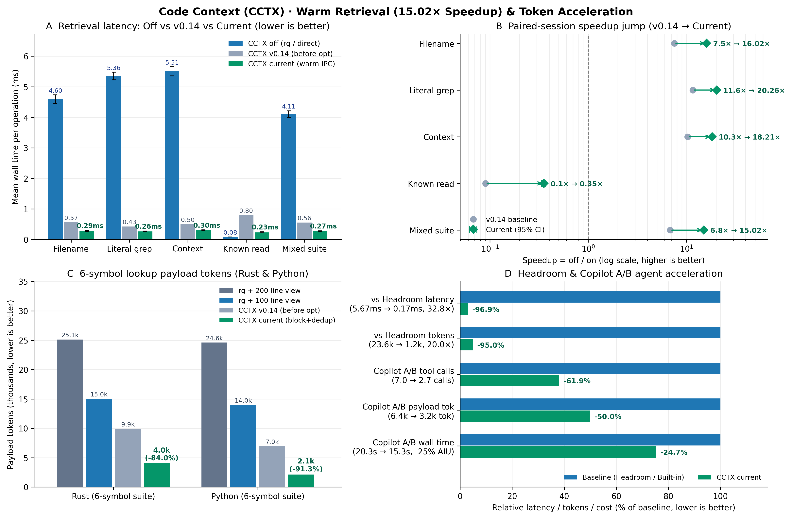

<p align="center">
  
</p>

# Code Context by dotnetpower

**Native VS Code source context for your coding agent on Linux, native Windows (`cctx.exe`), WSL, and SSH.**
Find files, search source, and read block-clamped nearby code with seven native VS Code Language Model Tools (`#cctxNativeContext`, `#cctxNativeGrep`, `#cctxNativeRead`, `#cctxNativeFiles`) backed by one shared Rust cache.
Publisher: **dotnetpower**. Previous VSIX users: [migration steps](docs/SETUP.md#extension-details-resources-and-vsix-updates).

## Resources

[Repository](https://github.com/dotnetpower/code-context) ·
[Setup](docs/SETUP.md) ·
[Tool reference](https://github.com/dotnetpower/code-context/blob/main/docs/REFERENCE.md#native-tools) ·
[Benchmark report](https://github.com/dotnetpower/code-context/blob/main/docs/BENCHMARKS.md) ·
[Issues](https://github.com/dotnetpower/code-context/issues) · [License](LICENSE)

VS Code's native right-hand Resources panel uses Marketplace metadata.
For VSIX-only installations, use the links above instead.

## Performance

On [AKS Store Demo](https://github.com/dotnetpower/aks-store-demo), the fixed
retrieval mix averaged **15.02× faster** with a warm CCTX cache
(95% CI **14.70–15.36×**, up from 6.83× in v0.14): **4.112 → 0.274 ms per operation**.
Replacing separate `rg` + `view` calls with one block-clamped `code_context` call cuts **lookup payload tokens by 73.2–91.3%** and reduces end-to-end coding agent wall time by **24.7%**.

| Task | CCTX off | CCTX on, warm | Off / on |
|---|---:|---:|---:|
| Filename discovery | 4.601 ms | 0.287 ms | 16.02× |
| Literal search | 5.365 ms | 0.265 ms | 20.26× |
| Search + context | 5.514 ms | 0.303 ms | 18.21× |
| Known read + hash | **0.083 ms** | 0.234 ms | **0.35× — slower** |
| Fixed mixed suite | 4.112 ms | 0.274 ms | 15.02× |

| Token & agent acceleration suite | Baseline (`rg` + `view`) | With CCTX (`code_context`) | Savings / speedup |
|---|---:|---:|---:|
| Rust 6-symbol lookup tokens | 15,028 tok (100L) / 25,133 tok (200L) | **4,031 tok** (6 calls vs 20, **10.3×** faster) | **-73.2% to -84.0% tokens** |
| Python 6-symbol lookup tokens | 13,997 tok (100L) / 24,609 tok (200L) | **2,141 tok** (**13.16×** faster) | **-84.7% to -91.3% tokens** |
| Copilot A/B agent turns & cost | 7.00 calls / 5.00 turns / 20.31 s | **2.67 calls / 3.67 turns / 15.30 s** | **-50.0% tok · -25.4% AIU · -24.7% time** |



Eight daemon sessions and 8,960 correctness-checked pairs; OS cache warm in both arms.
**Known small reads were slower through CCTX.** Cold misses fall back instead of waiting.
[Full method, cold-start chart, raw data, and reproduction](https://github.com/dotnetpower/code-context/blob/main/docs/BENCHMARKS.md)

## Install

> **Preview · Local backend required.** Supports **native Windows (`cctx.exe`, no WSL needed)**, Linux, WSL, or Linux SSH with stable Rust and ripgrep. VS Code 1.140+ is required; agent instructions (`applyTo: "**"`) attach automatically.

**1. Install the backend** (Linux/WSL/SSH or native Windows):

```sh
git clone https://github.com/dotnetpower/code-context.git && cd code-context
bash scripts/install.sh && ~/.local/bin/cctx ping
# Native Windows (PowerShell): cargo build --locked --release; copy target\release\cctx.exe $HOME\.local\bin\cctx.exe
```

**2. Download the [VSIX](https://github.com/dotnetpower/code-context/releases/latest/download/code-context-native.vsix).**
In VS Code choose **Extensions → … → Install from VSIX…**.

**3. Run Code Context: Getting Started** in a trusted workspace.
On Windows local folders (`C:\...`), `cctx.exe daemon` starts automatically in the background:

> Use `#cctxNativeFiles` to find `*Service*`, then `#cctxNativeContext` for nearby source.

**No proposed API flags are needed.** Marketplace publication is separate
from the downloadable VSIX. Windows, WSL, and troubleshooting details are in the **[setup guide](docs/SETUP.md)**.
The cache is optional: `CACHE_MISS` is not an empty search; continue with permitted host tools.
