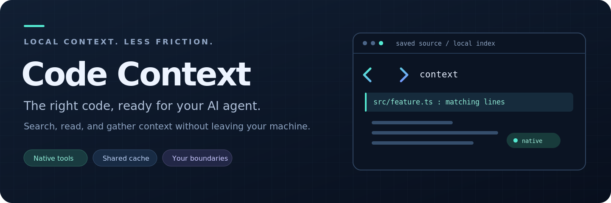
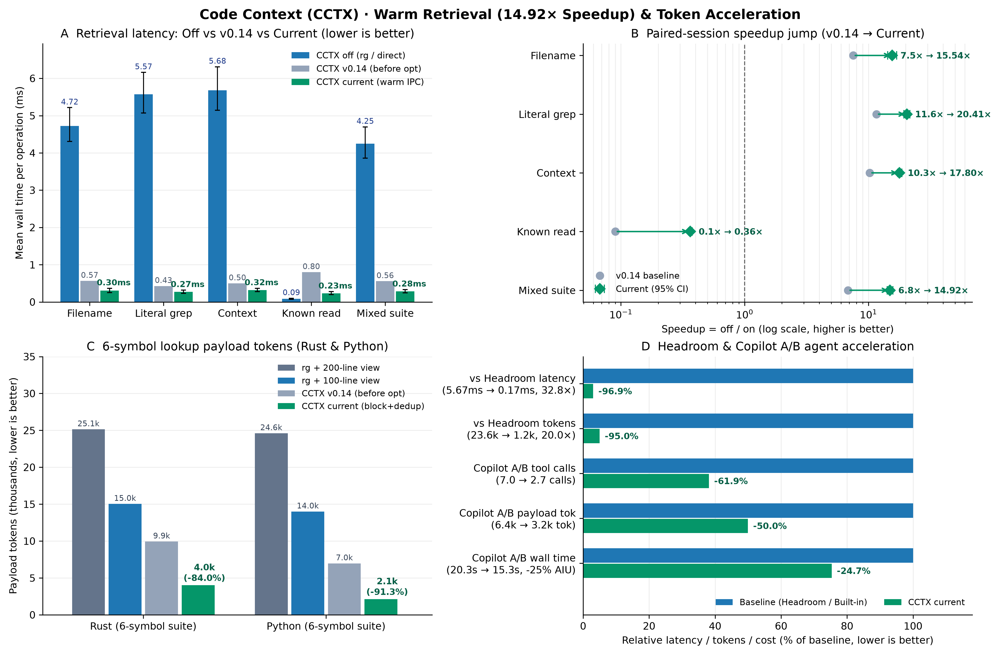

<p align="center">
  
</p>

# Code Context by dotnetpower

**Native VS Code source context for your coding agent on Linux, native Windows (`cctx.exe`), WSL, and SSH.**
Find files, search source, and read block-clamped nearby code with seven native VS Code Language Model Tools (`#cctxNativeContext`, `#cctxNativeGrep`, `#cctxNativeRead`, `#cctxNativeFiles`) backed by one shared Rust cache, `<8 KiB` inline response guards, rich document anchors (`#toc`, `#slide-N-M`, `#heading`), and live LLM model/token/AIC/USD cost savings telemetry.
Publisher: **dotnetpower**. Previous VSIX users: [migration steps](docs/SETUP.md#extension-details-resources-and-vsix-updates).

## Resources

[Repository](https://github.com/dotnetpower/code-context) ·
[Setup](docs/SETUP.md) ·
[Tool reference](https://github.com/dotnetpower/code-context/blob/main/docs/REFERENCE.md#native-tools) ·
[Benchmark report](https://github.com/dotnetpower/code-context/blob/main/docs/BENCHMARKS.md) ·
[Issues](https://github.com/dotnetpower/code-context/issues) · [License](LICENSE)

VS Code's native right-hand Resources panel uses Marketplace metadata.
For VSIX-only installations, use the links above instead.

## Performance & `cctx usage` example

```sh
$ cctx usage --hours 2        # or: cctx usage --hours 24 --json
⚡ CODE CONTEXT (cctx) — MODEL, TOKEN & COST SAVINGS DASHBOARD (Window: 2.0h)
💰 COST SAVED (@$0.001/AIC) : +$2.42 USD (-28.4% of baseline bill · ~2421.6 AIC saved)
💎 API LIST VALUE (@$0.01)  : +$24.22 USD | 🔥 TOKENS SAVED: ~86.02M tok (244 Turns + 35x Cache + BPE)
🎯 WARM CACHE HIT RATE      :  98.6% (506/513) | 🚀 ELIGIBLE SOURCE ADOPTION: 98.5% (513/521)
```

On [AKS Store Demo](https://github.com/dotnetpower/aks-store-demo), the fixed
retrieval mix averaged **17.22× faster** with a warm CCTX cache
(95% CI **17.04–17.40×**, up from 6.83× in v0.14): **3.996 → 0.232 ms per operation**, with a **19.735 ms** cold sync median (down from 98.813 ms in v0.14 — **5.01× faster**).
Replacing separate `rg` + `view` calls with one block-clamped `code_context` call cuts **lookup payload tokens by 73.2–91.3%**, rich document (`#toc` / `#slide-N`) reads by **86.3–98.9%**, and reduces end-to-end coding agent wall time by **24.7%**.

| Task | CCTX off | CCTX on, warm | Off / on |
|---|---:|---:|---:|
| Filename discovery | 4.466 ms | 0.254 ms | 17.57× |
| Literal search | 5.234 ms | 0.230 ms | 22.77× |
| Search + context | 5.343 ms | 0.250 ms | 21.39× |
| Known read + hash | **0.081 ms** | 0.190 ms | **0.43× — slower** |
| Fixed mixed suite | 3.996 ms | 0.232 ms | 17.22× |

| Token & agent acceleration suite | Baseline (`rg` + `view`) | With CCTX (`code_context` / `code_read`) | Savings / speedup |
|---|---:|---:|---:|
| Rust 6-symbol lookup tokens | 15,028 tok (100L) / 25,133 tok (200L) | **4,031 tok** (6 calls vs 20, **10.3×** faster) | **-73.2% to -84.0% tokens** |
| Python 6-symbol lookup tokens | 13,997 tok (100L) / 24,609 tok (200L) | **2,141 tok** (**13.16×** faster) | **-84.7% to -91.3% tokens** |
| Rich documents (`.pptx`/`.docx`/`.md` `#toc` & `#slide-N`) | Full-document read | **Virtual `#toc` + `#slide-N-M` (5.4× faster DEFLATE)** | **-86.3% to -98.9% tokens** |
| Copilot A/B agent turns & cost | 7.00 calls / 5.00 turns / 20.31 s | **2.67 calls / 3.67 turns / 15.30 s** | **-50.0% tok · -25.4% AIU · -24.7% time** |
| Live status bar & `cctx usage` telemetry | Unmonitored | **Per-model tokens, 98.6% warm hit & AIC/$USD savings** | **-10% to -39% session bill** |
| Auto-loaded instructions & `cctx prompt` | 9,127 B / 2,048 tok prose | **BPE-aligned formula spec (`756 tok`, EN/KO `--compress`)** | **-63.1% instruction tokens** |



Eight daemon sessions and 8,960 correctness-checked pairs; OS cache warm in both arms.
**Known small reads were slower through CCTX.** Cold misses fall back instead of waiting.
[Full method, cold-start chart, raw data, and reproduction](https://github.com/dotnetpower/code-context/blob/main/docs/BENCHMARKS.md)

## Install

> **Preview · Local backend required.** Supports **native Windows (`cctx.exe`, no WSL needed)**, Linux, WSL, or Linux SSH with stable Rust and ripgrep. VS Code 1.140+ is required; agent instructions (`applyTo: "**"`) attach automatically.

**1. Install the backend** (Linux/WSL/SSH or native Windows):

```sh
git clone https://github.com/dotnetpower/code-context.git && cd code-context
bash scripts/install.sh && ~/.local/bin/cctx ping
# Native Windows (PowerShell): cargo build --locked --release; copy target\release\cctx.exe $HOME\.local\bin\cctx.exe
```

**2. Download the [VSIX](https://github.com/dotnetpower/code-context/releases/latest/download/code-context-native.vsix).**
In VS Code choose **Extensions → … → Install from VSIX…**.

**3. Run Code Context: Getting Started** in a trusted workspace (hover the `CCTX N` status bar item or run `cctx usage --hours 24` to view live LLM model, token, cache hit, and AIC/$ cost savings).
On Windows local folders (`C:\...`), `cctx.exe daemon` starts automatically in the background:

> Use `#cctxNativeFiles` to find `*Service*`, then `#cctxNativeContext` for nearby source.

**No proposed API flags are needed.** Marketplace publication is separate
from the downloadable VSIX. Windows, WSL, and troubleshooting details are in the **[setup guide](docs/SETUP.md)**.
The cache is optional: `CACHE_MISS` is not an empty search; continue with permitted host tools.
